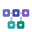

# Icons preview

Every icon in the Unified set, in one file, for visual review. Module icons are Icons8 Flat Color Icons (MIT-or-Good-Boy — see `LICENSE.flat-color-icons`): 48x48 grid, flat multi-tone fills with fixed colours, so they render identically on light and dark backgrounds. Payment and brand logos are real brand marks from [simple-icons](https://github.com/simple-icons/simple-icons) (CC0) where available, otherwise lettermark fallbacks in a consistent style.

## Module icons (156)

Built from `modules/*.svg` into `modules-sprite.svg` (`python3 scripts/build-module-icons-sprite.py`, 156 symbols, all viewBox 48). Full module → Flat Color name mapping: `docs/integration/SVGREPO_ICON_SETS.md` (§5 + §10).

|  academic |  admissions |  advisor |  affiliates |  ai |  ai-support |
| --- | --- | --- | --- | --- | --- |
|  analytics |  announcements |  api-manager |  apikeys |  app-sync |  appointments |
| --- | --- | --- | --- | --- | --- |
|  approvals |  assets |  audit |  auditors |  auth-manager |  backup |
| --- | --- | --- | --- | --- | --- |
|  bank-transfer |  bi |  billing |  cache |  calendar |  cards |
| --- | --- | --- | --- | --- | --- |
|  certificates |  chat |  cloudflare |  clusters |  community |  company |
| --- | --- | --- | --- | --- | --- |
|  compliance |  content |  contracts |  crm |  curriculum |  dashboards |
| --- | --- | --- | --- | --- | --- |
|  delivery-notes |  departments |  documents |  domain-verification |  domains |  downloader |
| --- | --- | --- | --- | --- | --- |
|  elearning |  email-providers |  email-templates |  entitlements |  esg |  events |
| --- | --- | --- | --- | --- | --- |
|  exams |  expenses |  extensions |  external-bi |  external-esignature |  external-fleet |
| --- | --- | --- | --- | --- | --- |
|  external-iot |  external-whatsapp |  field-service |  files |  forms |  forums |
| --- | --- | --- | --- | --- | --- |
|  frontend |  gamification |  geo |  holidays |  hosting |  hr |
| --- | --- | --- | --- | --- | --- |
|  i18n |  import-export |  inbox |  incidents |  knowledgebase |  kyc |
| --- | --- | --- | --- | --- | --- |
|  library |  licensing |  load-balancer |  logistics |  logs |  loyalty |
| --- | --- | --- | --- | --- | --- |
|  mail |  maintenance |  manufacturing |  marketing |  mcp |  meetings |
| --- | --- | --- | --- | --- | --- |
|  network |  network-tools |  newsletter |  notifications |  okrs |  panels |
| --- | --- | --- | --- | --- | --- |
|  payments |  phone |  placeholder |  planner |  plm |  portals |
| --- | --- | --- | --- | --- | --- |
|  pos |  presets |  pricing |  pricing-tables |  printing |  privacy |
| --- | --- | --- | --- | --- | --- |
|  procurement |  products |  projects |  properties |  providers |  quality |
| --- | --- | --- | --- | --- | --- |
|  records |  recruitment |  reference-data |  referral |  rental |  risk |
| --- | --- | --- | --- | --- | --- |
|  roles |  routes |  saas |  saas-domains |  saas-packages |  saved-views |
| --- | --- | --- | --- | --- | --- |
|  scheduler |  search |  security |  seo |  service-monitor |  settings |
| --- | --- | --- | --- | --- | --- |
|  sign |  site-builder |  sms-marketing |  social-marketing |  software |  spreadsheets |
| --- | --- | --- | --- | --- | --- |
|  statuspage |  storage |  storage-manager |  store |  studio |  supervision |
| --- | --- | --- | --- | --- | --- |
|  surveys |  tasks |  tax |  tenant-destroy |  tenants |  theme |
| --- | --- | --- | --- | --- | --- |
|  tickets |  timeline |  timetracker |  todos |  users |  vault |
| --- | --- | --- | --- | --- | --- |
|  vcs |  web3 |  webhooks |  webinars |  whitelabel |  workflows |
| --- | --- | --- | --- | --- | --- |

## Payment logos (25)

Built from `src/modules/payments/logos/*.svg` into `src/modules/payments/logos/sprite.svg` (`python3 scripts/build-provider-logos-sprite.py --src src/modules/payments/logos --glob 'payment-*.svg'`, 25 symbols).

### Providers — real brand marks (6)

|  xendit |  mastercard |  googlepay |  applepay |  paypal |  stripe |
| --- | --- | --- | --- | --- | --- |

### Providers — lettermark fallbacks (6)

|  hyperpay |  twocheckout |  card |  midtrans |  custom |  banktransfer |
| --- | --- | --- | --- | --- | --- |

### Card schemes — real brand marks (5)

|  visa |  americanexpress |  discover |  dinersclub |  jcb |
| --- | --- | --- | --- | --- |

### Indonesian methods — lettermarks (8)

|  dana |  ovo |  gopay |  qris |  shopeepay |  linkaja |
| --- | --- | --- | --- | --- | --- |
|  indomaret |  alfamart |
| --- | --- |

## Brand icons (14)

Built from `brands/*.svg` into `brands-sprite.svg` (`python3 scripts/build-provider-logos-sprite.py --src assets/icons/brands --glob 'brand-*.svg' --prefix '' --out assets/icons/brands-sprite.svg`, 14 symbols).

### Real brand marks (11)

|  cloudflare |  whatsapp |  telegram |  google |  apple |  github |
| --- | --- | --- | --- | --- | --- |
|  gitlab |  facebook |  x |  zoom |  bitbucket |
| --- | --- | --- | --- | --- |

### Lettermark fallbacks (3)

|  microsoft |  slack |  amazon |
| --- | --- | --- |

## Notes

- Country flags live in `flags/` (4x3 + 1x1, flag-icons MIT) — see `flags/PREVIEW.md`.
- Sub-module icons (582 Rust sub-module names) live in `submodules/` — see `SUBMODULES.md` and `docs/integration/SUBMODULE_ICONS.md`.
- The 17 snake_case `fn id()` modules have icons here, but they still cannot render in-app (needs the kebab unification decision).
