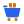
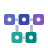

# Module & Mail Logo Preview (task 360)

Every logo in the Unified set, in one file, for visual review. Module icons are flat fill-only vectors (see `assets/icons/README.md`); mail logos are real brand marks from [simple-icons](https://github.com/simple-icons/simple-icons) (CC0) where available, otherwise lettermark fallbacks in a consistent style.

## Module icons (155)

Built from `assets/icons/modules/*.svg` into `assets/icons/modules-sprite.svg` (`python3 scripts/build-module-icons-sprite.py`, 155 symbols). Rendered colour + grayscale grids were inspected before sign-off.

|  academic |  admissions |  advisor |  affiliates |  ai-support |  ai |
| --- | --- | --- | --- | --- | --- |
|  analytics |  announcements |  api-manager |  apikeys |  app-sync |  appointments |
|  approvals |  assets |  audit |  auditors |  auth-manager |  backup |
|  bank-transfer |  bi |  billing |  cache |  calendar |  cards |
|  certificates |  chat |  cloudflare |  clusters |  community |  company |
|  compliance |  content |  contracts |  crm |  curriculum |  dashboards |
|  delivery-notes |  departments |  documents |  domain-verification |  domains |  downloader |
|  elearning |  email-providers |  email-templates |  entitlements |  esg |  events |
|  exams |  expenses |  extensions |  external-bi |  external-esignature |  external-fleet |
|  external-iot |  external-whatsapp |  field-service |  files |  forms |  forums |
|  frontend |  gamification |  geo |  holidays |  hosting |  hr |
|  i18n |  import-export |  inbox |  incidents |  knowledgebase |  kyc |
|  library |  licensing |  load-balancer |  logistics |  logs |  loyalty |
|  mail |  maintenance |  manufacturing |  marketing |  mcp |  meetings |
|  network-tools |  network |  newsletter |  notifications |  okrs |  panels |
|  payments |  phone |  placeholder |  planner |  plm |  portals |
|  pos |  presets |  pricing-tables |  pricing |  printing |  privacy |
|  procurement |  products |  projects |  properties |  providers |  quality |
|  records |  recruitment |  referral |  rental |  risk |  roles |
|  routes |  saas-domains |  saas-packages |  saas |  saved-views |  scheduler |
|  search |  security |  seo |  service-monitor |  settings |  sign |
|  site-builder |  sms-marketing |  social-marketing |  software |  spreadsheets |  statuspage |
|  storage-manager |  storage |  store |  studio |  supervision |  surveys |
|  tasks |  tax |  tenant-destroy |  tenants |  theme |  tickets |
|  timeline |  timetracker |  todos |  users |  vault |  vcs |
|  web3 |  webhooks |  webinars |  whitelabel |  workflows |

## Mail provider logos (56)

### Real brand marks from simple-icons (22 files, 21 providers)

Brand marks are the brands' trademarks, used only to identify their services. Fetched from the simple-icons CDN in brand colour; `zoho` and `zoho-eu` share the `zoho` mark.

|  brevo |  campaign-monitor |  gandi |  gmail |  gmx |  icloud |
| --- | --- | --- | --- | --- | --- |
|  infomaniak |  loops |  mail-com |  mail-ru |  mailchimp |  mailgun |
|  mailtrap |  migadu |  namecheap |  ovh |  proton |  qq-mail |
|  resend |  sparkpost |  zoho-eu |  zoho |

### Lettermark fallbacks (34 providers)

No simple-icons entry exists for these providers, so they keep a lettermark in the consistent house style (initials on a rounded rect) — no gaps, no invented trademark artwork. Seven of them (`outlook`, `postmark`, `sendgrid`, `sendmail`, `ses`, `smtp`, `yahoo`) are the original hand-drawn marks from before task 354, not lettermarks.

|  aol |  courier |  dreamhost |  elastic-email |  fastmail |  kolabnow |
| --- | --- | --- | --- | --- | --- |
|  mail-126 |  mail-163 |  mailersend |  mailfence |  mailjet |  mxroute |
|  onesignal |  outlook |  pepipost |  plunk |  posteo |  postmark |
|  runbox |  sender-net |  sendgrid |  sendlayer |  sendmail |  sendpulse |
|  ses |  sina |  smtp-com |  smtp |  smtp2go |  socketlabs |
|  startmail |  yahoo |  yandex |  zeptomail |

## Notes

- `yandex` is NOT in simple-icons (only `yandexcloud`, a different product) — the Yandex Cloud mark was deliberately NOT substituted for Yandex Mail; it stays a lettermark.
- `sina` / `elastic-email`: only `sinaweibo` / `elastic` exist (different brands) — not substituted.
- 17 modules have snake_case `fn id()` values the icon system cannot match (kebab-only); that is a separate, out-of-scope decision — see the module naming audit. Their icons exist here but cannot render until that is decided.
